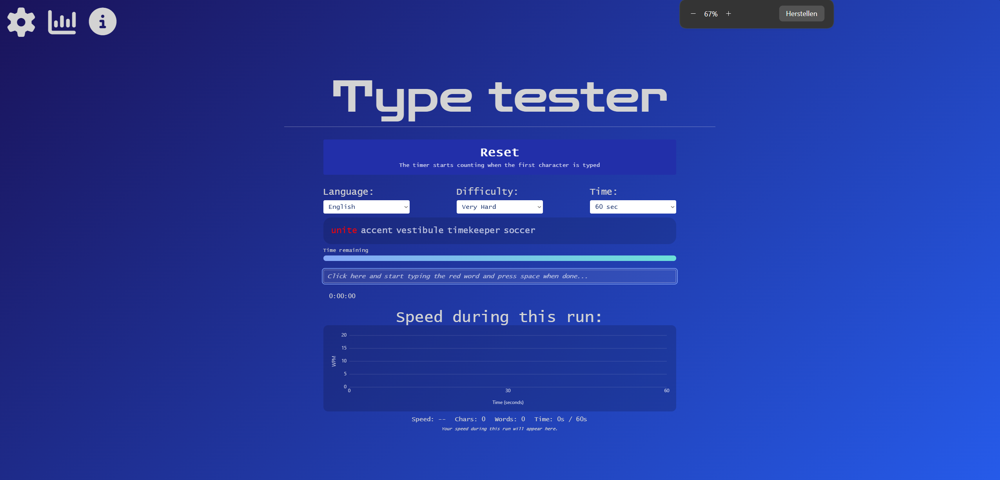
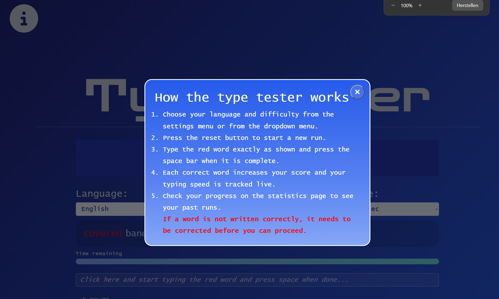
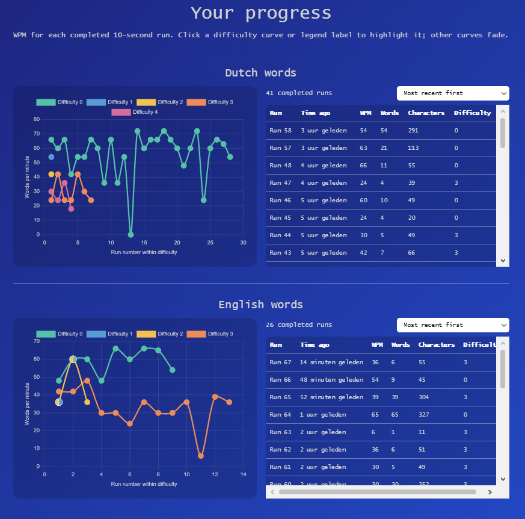
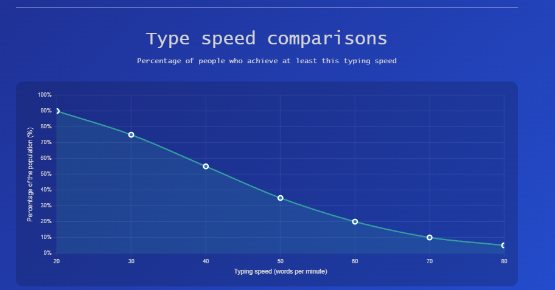

# Test-typ-snelheid
**A website to test and improve your typing skills**
Made by Team 005: TestTypSnelheidTeam team as a project for Project Informatica

Testypesnelheidtest is gemaakt zodat scholieren kunnen meten hoeveel woorden ze per minuut kunnen typen. Daarnaast laat de website zien aan de scholieren hoe goed ze het hebben gedaan in vergelijking met andere scholieren. Dit kan hun bijvoorbeeld motiveren om beter te leren typen. 

De website doelt op alle scholieren tussen 12 en 20. Er zijn dus ook verschillende niveaus testen gemaakt, zodat iedereen tussen de leeftijden deze test kunnen uitvoeren.

 - geeft de homepagina weer. Hier komen de scholieren op terecht als ze de pagina openen. Op de pagina zien ze in het midden gelijk de tester waarmee ze hun eigen typsnelheid kunnen testen. De tester bestaat uit verschillende onderdelen. De reset knop, Dropdown menuus waar dingen kunnen worden ingesteld, de tekst die geschreven moet worden, de tijd die over is, het invulvak, de snelheid van de huidige typesessie en nog meer gegevens van huidige typesessie. In de instructies op de pagina staat meer over hoe alles werkt: 
Linksbovenin staan drie icoontjes waarmee ze instellingen kunnen openen, naar de statistiek pagina kunnen gaan en als laatste een uitleg kunnen krijgen over hoe de type tester werkt.

op de statistieken pagina zijn twee verschillende soorten statistieken te zien. De eerste zijn de persoonsgebonden statestieken. Dit zijn de statestieken op basis van de resultaten van de testen die iemand heeft gedaan.

Er zijn een heleboel gegevens uit te lezen van de gemaakte tests. WPM, geschreven woorden, aantal geschreven karakter en de moeilijkheidsgraad.
De tweede soort statestiek is zijn de gemiddelden van mensen tussen de 12 en 20 jaar oud. Op deze grafiek is af te lezen hoeveel procent van de mensen van deze leeftijd een bepaalde typesnelheid hebben

## Beoordelingscriteria
- Website
- Programmeren
- User experience

## Features

- **Taalondersteuning**: Je kunt in zowel het Engels als het Nederlands typen. 
- **Moeilijkheidsgraad**: Woorden worden ingedeeld op basis van hun type-moeilijkheidsgraad. Factoren zoals woordlengte, tekencombinaties, het verplaatsen van vingers tussen rijen op het toetsenbord, afwisseling tussen vingers en handen, enzovoort, worden meegewogen om de moeilijkheidsgraad van een woord te bepalen. 
- **Onbeperkt typen**: De enige beperking voor het aantal woorden dat je in een bepaalde tijd kunt typen, is je eigen typsnelheid! 
- **Directe feedback**: Zodra je een test hebt afgerond, zie je direct je snelheid, het aantal gemaakte fouten, het aantal getypte woorden en meer. Daarnaast is er een grafiek die bij elk getypt woord wordt bijgewerkt, zodat je het verloop van je snelheid in realtime kunt volgen. 
- **Statistieken**: De statistiekenpagina is ideaal om je voortgang bij te houden via interactieve grafieken en tabellen. Ook worden er algemene statistieken getoond, zodat je jouw resultaten kunt vergelijken met die van een gemiddelde gebruiker. 
- **Voortgang opslaan**: De website slaat je voortgang op; zelfs als je de site afsluit, blijft je voortgang bewaard (deze wordt lokaal in je browser opgeslagen). Je kunt je gegevens op elk gewenst moment verwijderen via de instellingen.

## Hoe open je het product
- Open Product/home.html uit het ingeleverde bestandje. Het kan lokaal geopend worden. Mocht het reset systeem niet werken kopieër dan de repo en run home.html via een live server
- Open het bijgevoegde bestand over het gebruikersonderzoek

## Hoe te gebruiken
1. **Selecteer je taal**: Kies Engels of Nederlands. Dit bepaalt de taal van de woorden die je gaat typen.
2. **Selecteer een moeilijkheidsgraad**: Van 'makkelijk' tot 'onmogelijk'. Dit bepaalt hoe uitdagend de woorden zijn die je moet typen.
3. **Klik op 'reset'**: Hiermee worden nieuwe woorden gegenereerd.
4. **Klik in het tekstveld**: Geen zorgen, de timer start pas zodra je begint met typen; je hebt dus alle tijd om je voor te bereiden.
5. **Begin met typen**: Zodra je er klaar voor bent, typ je het eerste woord. Druk na het typen van een woord op de spatiebalk om door te gaan naar het volgende woord. Als je een fout maakt, moet je deze corrigeren voordat je verder kunt – probeer dus om geen fouten te maken!
6. **Bekijk je resultaten**: Nadat je klaar bent, kun je je prestaties bekijken in de grafiek onder het tekstveld, of naar de statistiekenpagina gaan om je resultaten te vergelijken. Je kunt natuurlijk ook direct aan een nieuwe sessie beginnen.

## Bronnen
### Woorddatasets
- Voor het Engelse woordenboek is de GitHub-[repository](https://github.com/Gamezxz/flashcard/blob/main/data/vocabulary.json) 'flashcard' van Gamezxz en andere bijdragers als referentie gebruikt.
- Voor het Nederlandse woordenboek is de GitHub-[repository](https://github.com/OpenTaal/opentaal-wordlist) van © Stichting OpenTaal gebruikt, onder de BSD- / CC BY 3.0-licentie.
- Voor de statistische grafieken is de GitHub-[repository](https://github.com/chartjs/Chart.js) van Evert Timberg gebruikt.

## Gebruik van AI
Kunstmatige intelligentie (AI) is ingezet als *ondersteuning* bij het schrijven van code en bij het beantwoorden van vragen. Alle door AI aangebrachte wijzigingen zijn nauwlettend gevolgd, gecontroleerd en waar nodig aangepast. Door AI gegenereerde code is grondig getest.
